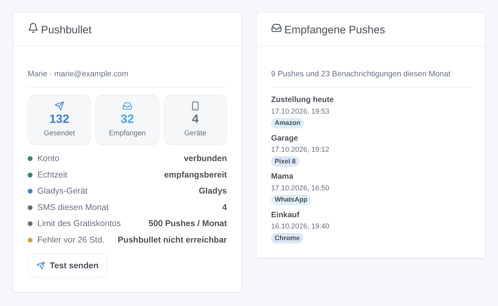
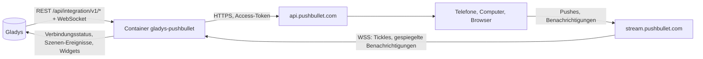
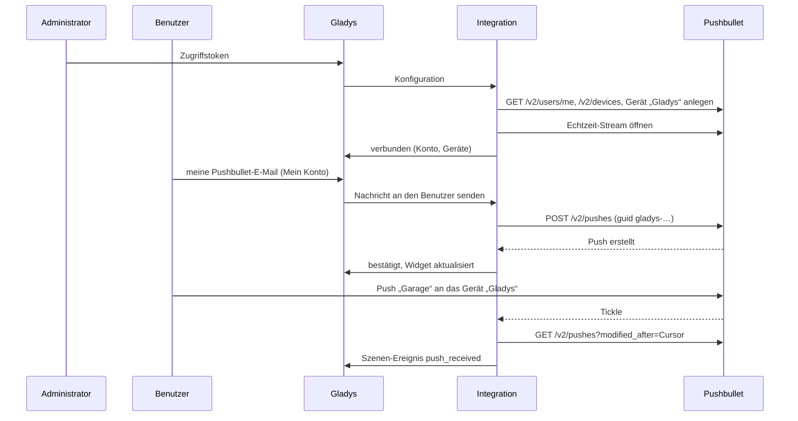

# Gladys Pushbullet

[English](README.md) · [Français](README.fr.md) · **Deutsch** · [Español](README.es.md)

[](LICENSE)
[](https://github.com/William-De71/gladys-pushbullet/releases)
[](https://github.com/William-De71/gladys-pushbullet/actions/workflows/release.yml)
[](https://gladysassistant.com)


Externe Integration für [Gladys Assistant](https://gladysassistant.com), die die Benachrichtigungen von Gladys **als [Pushbullet](https://www.pushbullet.com)-Pushes** an Ihre Telefone, Computer und Browser sendet, Kamerabilder inklusive. Szenen können außerdem auf die Pushes und Android-Benachrichtigungen reagieren, die auf Ihrem Pushbullet-Konto ankommen, Notizen, Links und SMS senden, und zwei Dashboard-Widgets zeigen das Konto und das Empfangene.

Benutzerdokumentation: [English](docs/en.md) · [Français](docs/fr.md) · [Deutsch](docs/de.md) · [Español](docs/es.md).

> Community-Integration, weder mit Pushbullet Inc. verbunden noch von ihr unterstützt.

## Funktionen

- **Benachrichtigungskanal** (nur Senden): Jeder Benutzer gibt die E-Mail seines Pushbullet-Kontos im Block „Mein Konto“ ein (und optional ein Gerät); jede an ihn gerichtete Gladys-Benachrichtigung geht als Push hinaus, ein Kamerabild als Bild.
- **Ein Gerät „Gladys“** im Konto: Pushen Sie über das Teilen-Menü eines Telefons an Gladys und sehen Sie, woher die Pushes von Gladys kommen.
- **Empfang in Echtzeit** über den Stream von Pushbullet: keine periodische Abfrage.
- **Szenen-Auslöser**: Push empfangen (Filter nach Ziel, Herkunft, erstem Wort, Absender und Art), von Android gespiegelte Telefon-Benachrichtigung (Filter nach App, Telefon und erstem Wort; Ende-zu-Ende-Verschlüsselung unterstützt), Push nicht gesendet.
- **Szenen-Aktionen**: eine Notiz oder einen Link an alle Geräte, ein Gerät, eine andere Person oder einen Kanal senden; eine SMS über ein Android-Telefon senden.
- **Dashboard-Widgets**: Konto, empfangene Pushes.
- **Schaltflächen im Konfigurationsbildschirm**: Verbindung testen, Test-Push senden.
- Englisch, Französisch, Deutsch und Spanisch überall.



## Funktionsweise




Von der Konfiguration zu einem Push und zurück:



Jeder Push von Gladys trägt eine `guid`, die mit `gladys-` beginnt: Ein wiederholter Push wird nicht doppelt erstellt, und der Empfang hält ihn nie für einen Push des Benutzers.

### Transport

`transports: ["cloud"]`: Die Integration spricht nur mit Pushbullet (`api.pushbullet.com`, `stream.pushbullet.com` und `upload.pushbullet.com` für die Bilder). Die Texte der Benachrichtigungen, die empfangenen Pushes und, wenn aktiviert, die gespiegelten Benachrichtigungen Ihres Telefons laufen über die Server von Pushbullet.

## Benachrichtigungen und Empfänger

| E-Mail in „Mein Konto“          | Gerät in „Mein Konto“ | Der Push geht an                       |
| ------------------------------- | --------------------- | -------------------------------------- |
| Die E-Mail des Token-Kontos     | leer                  | alle Geräte des Kontos                 |
| Die E-Mail des Token-Kontos     | `Pixel 8`             | das Gerät namens Pixel 8               |
| Ein anderer Pushbullet-Benutzer | ignoriert             | diesen Benutzer (seine eigenen Geräte) |
| Eine Adresse ohne Pushbullet    | ignoriert             | eine E-Mail, von Pushbullet gesendet   |

Ein von Gladys angehängtes Bild („Kamerabild senden“) wird hochgeladen und als Datei-Push gesendet. Ein Gratiskonto sendet 500 Pushes pro Monat, alle Apps zusammen.

## Szenenauslöser, Aktionen und Widgets

| Art      | Schlüssel               | Anwendungsfall                                                                                                    |
| -------- | ----------------------- | ----------------------------------------------------------------------------------------------------------------- |
| Auslöser | `push_received`         | Eine Szene vom Telefon aus steuern: „Garage“ an das Gerät „Gladys“ teilen; auf einen geteilten Link reagieren     |
| Auslöser | `notification_mirrored` | Auf eine App des Telefons reagieren: Lieferung, Türklingel, verpasster Anruf                                      |
| Auslöser | `push_not_sent`         | Über einen anderen Kanal warnen, wenn keine Pushes mehr hinausgehen (Limit, Token widerrufen, Pushbullet gestört) |
| Aktion   | `send_push`             | Ein Link zu einem Dashboard, eine Notiz an jemanden ohne Gladys, ein Familienkanal                                |
| Aktion   | `send_sms`              | Eine SMS von Ihrem eigenen Telefon und Tarif, an den Nachbarn oder den Babysitter                                 |
| Widget   | `account`               | Pushes des Monats im Vergleich zum Gratis-Limit, Geräte, Echtzeit, letzter Fehler, Test-Schaltfläche              |
| Widget   | `recent`                | Die zuletzt empfangenen Pushes und Telefon-Benachrichtigungen                                                     |

Beispiele: _Push, der mit GARAGE beginnt, am Gerät „Gladys“ von einem meiner Geräte_ → Garage schließen; _Benachrichtigung der Liefer-App_ → Eingangslicht an; _Alarm_ → Push mit einem Link zu den Kameras und SMS an den Nachbarn. Ein anderer Pushbullet-Benutzer kann an Ihre E-Mail pushen: Filtern Sie nach Herkunft oder Absender, bevor Sie eine Tür öffnen. Eine Szenen-Aktion löst nie einen Auslöser aus, und `push_not_sent` löst nur einmal aus, bis ein Push durchgeht: Eine Szene, die über denselben Kanal warnt, kann keine Schleife bilden.

## Voraussetzungen

- Gladys Assistant 5.1.0 oder neuer (Widgets und Szenen); ältere Instanzen können die Integration nicht installieren.
- Ein Pushbullet-Konto und seine Apps auf Ihren Geräten; optional ein Android-Telefon für SMS und gespiegelte Benachrichtigungen.

## Installation

- **Aus dem Store**: Integrationen → Pushbullet → Installieren.
- **Über die URL des Repositorys**: Integrationen → externe Integration → `https://github.com/William-De71/gladys-pushbullet`.
- **Entwicklermodus**: Starten Sie `npm start` mit den von Gladys gelieferten Variablen (siehe Entwicklung).

## Konfiguration

| Feld                                      | Standard | Bedeutung                                                                      |
| ----------------------------------------- | -------- | ------------------------------------------------------------------------------ |
| Zugriffstoken                             | —        | Pushbullet → Settings → Account → Create Access Token; `secret`, verschlüsselt |
| Titel der Benachrichtigungen              | Gladys   | Über jeder Nachricht                                                           |
| Sprache des Test-Pushs                    | Englisch | Nur der Test-Push (eine Schaltfläche erhält nicht die Sprache des Benutzers)   |
| Gerät „Gladys“ hinzufügen                 | an       | Gerät, um nur an Gladys zu pushen, Herkunft der Pushes von Gladys              |
| Name des Geräts                           | Gladys   | Wird beim Anlegen des Geräts verwendet                                         |
| Empfangene Pushes                         | an       | Echtzeit-Stream, `push_received`                                               |
| Gespiegelte Benachrichtigungen            | aus      | `notification_mirrored`                                                        |
| Passwort der Ende-zu-Ende-Verschlüsselung | —        | `secret`, nur bei aktivierter Verschlüsselung in den Pushbullet-Apps           |
| Mein Konto → E-Mail                       | —        | Pro Benutzer: das Pushbullet-Konto seiner Benachrichtigungen                   |
| Mein Konto → Gerät                        | —        | Pro Benutzer, optional: ein Gerät des Token-Kontos                             |

## Verwendung

1. Erstellen Sie auf pushbullet.com ein Zugriffstoken, fügen Sie es in die Konfiguration ein und klicken Sie dann auf **Verbindung testen** und **Test-Push senden**.
2. Jeder Benutzer gibt die E-Mail seines Pushbullet-Kontos in **Mein Konto** ein.
3. Fügen Sie die Widgets einem Dashboard hinzu und erstellen Sie Szenen mit den Auslösern und Aktionen.

## Entwicklung

```bash
npm install
npm test                       # node --test, berührt nie das Netzwerk
npm run lint                   # ESLint
npm run format:check           # Prettier
npx github:GladysAssistant/integration-store . --skip-image-check
scripts/build-cover.sh         # cover.jpg aus docs/assets/cover.svg
docs/illustrations/render.sh   # docs/assets/widgets.<lang>.png
```

Lokal liest das SDK `GLADYS_HOST_API_URL`, `GLADYS_INTEGRATION_TOKEN` und `GLADYS_INTEGRATION_SELECTOR` (von Gladys im Entwicklermodus geliefert). `DEBUG=gladys-integration-sdk` zeigt die Protokolle des SDK.

Die Tests decken die Fehlergründe der API ab, die Wiederholungen (einmal, mit derselben guid), den Upload, die Ende-zu-Ende-Entschlüsselung (die Vektoren von docs.pushbullet.com), den Stream (Neuverbindung, Watchdog), den Empfang (Historie, eigene Pushes, verspätete Pushes, Neustart), die Empfänger der Benachrichtigungen, die Szenen-Ereignisse und ihre Übergänge, die Widgets (`validateWidgetContent`), das Manifest, die vier Sprachen, das Release-Skript und die ganze Integration gegen das gefälschte Gladys des SDK, ein gefälschtes Pushbullet und einen gefälschten Stream. `test/structure.test.js` friert jeden Schlüssel ein, den Benutzer speichern.

## Release-Prozess


Jeder Merge auf `main` startet die CI und berechnet dann die Version aus den [Conventional Commits](https://www.conventionalcommits.org/) seit dem letzten Tag: `feat` → Minor, `fix` / `perf` → Patch, `!` oder `BREAKING CHANGE` → Major (unter 1.0.0 ein Minor); `docs`, `chore`, `ci`, `test`, `style`, `refactor`, `build` allein veröffentlichen nichts. Der Changelog-Abschnitt wird erzeugt, der Tag gepusht, das Multi-Architektur-Image gebaut, dann erhält `main` den Release-Commit, das GitHub-Release wird erstellt und ein letzter Job prüft das öffentliche Image, den Store-Validator und das Topic.

- Der Titel des Pull-Requests wird zum Squash-Commit und dann zur Changelog-Zeile: Schreiben Sie ihn auf Englisch, für den Benutzer (`pr-title.yml` prüft ihn). Bearbeiten Sie `CHANGELOG.md` nie von Hand.
- 1.0.0 ist eine Entscheidung: Actions → Release → Run workflow mit `release-as: 1.0.0`. `dry-run` zeigt Version und Notizen, ohne zu veröffentlichen.
- **Geschützter Branch**: Das Release pusht seinen Commit mit `GITHUB_TOKEN` auf `main`. Mit einem Ruleset auf `main` fügen Sie GitHub Actions zu dessen Bypass-Liste hinzu (oder pushen über eine GitHub App), sonst schlägt der Veröffentlichungs-Job mit Anweisungen fehl.
- Machen Sie nach dem ersten Release das Paket auf `ghcr.io` öffentlich (Package settings → Change visibility), sonst kann Gladys es nicht herunterladen.

## Fehlerbehebung

Siehe [docs/de.md](docs/de.md#fehlerbehebung). Melden Sie Probleme mit den Versionen von Gladys und der Integration, Gratis- oder Pro-Konto, der Art der Geräte und den Protokollen der Integration (E-Mail-Adressen sind maskiert; fügen Sie nie das Token ein).

## Mitwirken

Issues und Pull-Requests sind willkommen. Führen Sie `npm run format:check && npm run lint && npm test` aus, bevor Sie einen Pull-Request öffnen, und lassen Sie jeden gespeicherten Schlüssel unverändert (siehe [CLAUDE.md](CLAUDE.md)).

## Sicherheit

Siehe [SECURITY.md](SECURITY.md): Melden Sie Schwachstellen vertraulich. Das Zugriffstoken und das Verschlüsselungspasswort sind `secret`-Felder, nie protokolliert, nie in einer Fehlermeldung, einem Szenen-Ereignis oder einem Widget; die Stream-URL, die das Token trägt, wird nie protokolliert, und der Upload-Server erhält es nie. E-Mail-Adressen sind in den Protokollen maskiert. Das Token gewährt vollen Zugriff auf das Pushbullet-Konto: Die Integration sendet nur Pushes und SMS, liest die Pushes und fügt ein Gerät hinzu.

## Kommende Screenshots

Die Bilder oben sind Illustrationen, keine Screenshots. Echte Screenshots kommen nach `docs/assets/screenshots/` (PNG, 1280 × 800): `configuration.png`, `my-account.png`, `scene-trigger.png`, `dashboard.png` und ein Telefon-Screenshot `push-on-phone.png` (1080 × 2340).

## Lizenz

[Apache-Lizenz 2.0](LICENSE) — siehe auch [NOTICE](NOTICE). Pushbullet ist eine Marke von Pushbullet Inc.; diese Community-Integration ist nicht mit ihr verbunden. Danke an die Dokumentation und das SDK von Gladys.
