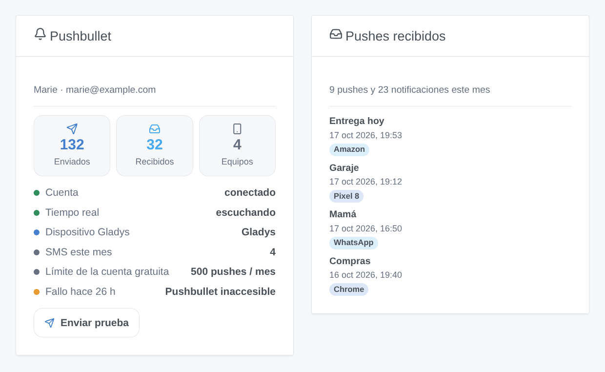
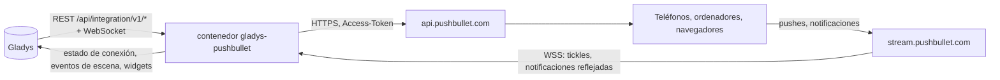
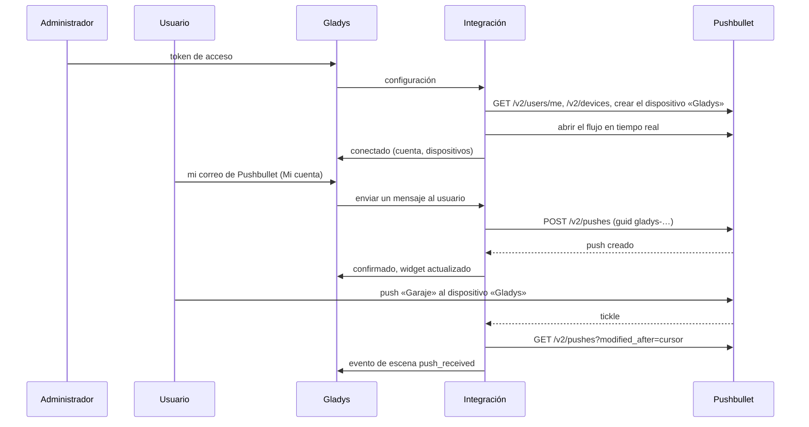

# Gladys Pushbullet

[English](README.md) · [Français](README.fr.md) · [Deutsch](README.de.md) · **Español**

[](LICENSE)
[](https://github.com/William-De71/gladys-pushbullet/releases)
[](https://github.com/William-De71/gladys-pushbullet/actions/workflows/release.yml)
[](https://gladysassistant.com)


Integración externa para [Gladys Assistant](https://gladysassistant.com) que envía las notificaciones de Gladys **como pushes de [Pushbullet](https://www.pushbullet.com)** a sus teléfonos, ordenadores y navegadores, imágenes de cámara incluidas. Las escenas también pueden reaccionar a los pushes y a las notificaciones de Android que llegan a su cuenta de Pushbullet, enviar notas, enlaces y SMS, y dos widgets de panel muestran la cuenta y lo que ha llegado.

Documentación de usuario: [English](docs/en.md) · [Français](docs/fr.md) · [Deutsch](docs/de.md) · [Español](docs/es.md).

> Integración comunitaria, sin afiliación ni respaldo de Pushbullet Inc.

## Funcionalidades

- **Canal de notificación** (solo envío): cada usuario introduce el correo de su cuenta de Pushbullet en el bloque «Mi cuenta» (y, si quiere, un dispositivo); cada notificación de Gladys dirigida a él sale como push, una imagen de cámara como imagen.
- **Un dispositivo «Gladys»** añadido a la cuenta: envíe pushes a Gladys desde el menú Compartir de un teléfono, y vea de dónde vienen los pushes de Gladys.
- **Recepción en tiempo real** mediante el flujo de Pushbullet: sin consultas periódicas.
- **Disparadores de escena**: push recibido (filtros por destino, procedencia, primera palabra, remitente y tipo), notificación del teléfono reflejada por Android (filtros por aplicación, teléfono y primera palabra; cifrado de extremo a extremo compatible), push no enviado.
- **Acciones de escena**: enviar una nota o un enlace a todos los dispositivos, a uno, a otra persona o a un canal; enviar un SMS a través de un teléfono Android.
- **Widgets de panel**: cuenta, pushes recibidos.
- **Botones de la pantalla de configuración**: probar la conexión, enviar un push de prueba.
- Inglés, francés, alemán y español en todas partes.



## Funcionamiento




De la configuración a un push, y de vuelta:



Cada push de Gladys lleva un `guid` que empieza por `gladys-`: un push reintentado no se crea dos veces, y la recepción nunca lo confunde con un push del usuario.

### Transporte

`transports: ["cloud"]`: la integración solo habla con Pushbullet (`api.pushbullet.com`, `stream.pushbullet.com` y `upload.pushbullet.com` para las imágenes). El texto de las notificaciones, los pushes recibidos y, si están activadas, las notificaciones reflejadas de su teléfono pasan por los servidores de Pushbullet.

## Notificaciones y destinatarios

| Correo en «Mi cuenta»            | Dispositivo en «Mi cuenta» | El push va a                           |
| -------------------------------- | -------------------------- | -------------------------------------- |
| El correo de la cuenta del token | vacío                      | todos los dispositivos de la cuenta    |
| El correo de la cuenta del token | `Pixel 8`                  | el dispositivo llamado Pixel 8         |
| Otro usuario de Pushbullet       | se ignora                  | ese usuario (sus propios dispositivos) |
| Una dirección sin Pushbullet     | se ignora                  | un correo, enviado por Pushbullet      |

Una imagen adjuntada por Gladys («Enviar una imagen de cámara») se sube y se envía como push de archivo. Una cuenta gratuita envía 500 pushes al mes, sumando todas las aplicaciones.

## Disparadores, acciones de escena y widgets

| Tipo       | Clave                   | Caso de uso                                                                                                           |
| ---------- | ----------------------- | --------------------------------------------------------------------------------------------------------------------- |
| Disparador | `push_received`         | Controlar una escena desde el teléfono: compartir «Garaje» al dispositivo «Gladys»; reaccionar a un enlace compartido |
| Disparador | `notification_mirrored` | Reaccionar a una aplicación del teléfono: reparto, timbre, llamada perdida                                            |
| Disparador | `push_not_sent`         | Avisar por otro canal cuando los pushes dejan de salir (límite, token revocado, Pushbullet caído)                     |
| Acción     | `send_push`             | Un enlace a un panel, una nota a alguien que no usa Gladys, un canal familiar                                         |
| Acción     | `send_sms`              | Un SMS desde su propio teléfono y tarifa, al vecino o a la canguro                                                    |
| Widget     | `account`               | Pushes del mes frente al límite gratuito, dispositivos, tiempo real, último fallo, botón de prueba                    |
| Widget     | `recent`                | Los últimos pushes y notificaciones del teléfono recibidos                                                            |

Ejemplos: _push que empieza por GARAJE en el dispositivo «Gladys» desde uno de mis dispositivos_ → cerrar el garaje; _notificación de la aplicación de reparto_ → encender la entrada; _alarma_ → push con un enlace a las cámaras y SMS al vecino. Otro usuario de Pushbullet puede enviar pushes a su correo: filtre por procedencia o remitente antes de abrir una puerta. Una acción de escena nunca activa un disparador, y `push_not_sent` solo se activa una vez hasta un push correcto: una escena que avisa por este mismo canal no puede entrar en bucle.

## Requisitos previos

- Gladys Assistant 5.3.0 o posterior (widgets y escenas, el catálogo de palabras clave/países de Gladys 5.3); las instancias más antiguas no pueden instalar la integración.
- Una cuenta de Pushbullet y sus aplicaciones en sus dispositivos; opcionalmente un teléfono Android para los SMS y las notificaciones reflejadas.

## Instalación

- **Desde la tienda**: Integraciones → Pushbullet → Instalar.
- **Desde la URL del repositorio**: Integraciones → integración externa → `https://github.com/William-De71/gladys-pushbullet`.
- **Modo desarrollador**: ejecute `npm start` con las variables que da Gladys (ver Desarrollo).

## Configuración

| Campo                                       | Por defecto | Significado                                                                  |
| ------------------------------------------- | ----------- | ---------------------------------------------------------------------------- |
| Token de acceso                             | —           | Pushbullet → Settings → Account → Create Access Token; `secret`, cifrado     |
| Título de las notificaciones                | Gladys      | Encima de cada mensaje                                                       |
| Idioma del push de prueba                   | inglés      | Solo el push de prueba (un botón no recibe el idioma del usuario)            |
| Añadir un dispositivo «Gladys»              | activado    | Dispositivo para enviar pushes solo a Gladys, origen de los pushes de Gladys |
| Nombre del dispositivo                      | Gladys      | Se usa al crear el dispositivo                                               |
| Pushes recibidos                            | activado    | Flujo en tiempo real, `push_received`                                        |
| Notificaciones reflejadas                   | desactivado | `notification_mirrored`                                                      |
| Contraseña del cifrado de extremo a extremo | —           | `secret`, solo con el cifrado activado en las aplicaciones de Pushbullet     |
| Mi cuenta → correo                          | —           | Por usuario: la cuenta de Pushbullet de sus notificaciones                   |
| Mi cuenta → dispositivo                     | —           | Por usuario, opcional: un dispositivo de la cuenta del token                 |

## Uso

1. Cree un token de acceso en pushbullet.com, péguelo en la configuración y pulse **Probar la conexión** y **Enviar un push de prueba**.
2. Cada usuario introduce el correo de su cuenta de Pushbullet en **Mi cuenta**.
3. Añada los widgets a un panel y cree escenas con los disparadores y las acciones.

## Desarrollo

```bash
npm install
npm test                       # node --test, nunca toca la red
npm run lint                   # ESLint
npm run format:check           # Prettier
npx github:GladysAssistant/integration-store . --skip-image-check
scripts/build-cover.sh         # cover.jpg a partir de docs/assets/cover.svg
docs/illustrations/render.sh   # docs/assets/widgets.<lang>.png
```

En local, el SDK lee `GLADYS_HOST_API_URL`, `GLADYS_INTEGRATION_TOKEN` y `GLADYS_INTEGRATION_SELECTOR` (que da Gladys en modo desarrollador). `DEBUG=gladys-integration-sdk` muestra los registros del SDK.

Las pruebas cubren los motivos de error de la API, los reintentos (uno, con el mismo guid), la subida, el descifrado de extremo a extremo (los vectores de docs.pushbullet.com), el flujo (reconexión, vigilancia), la recepción (historial, pushes propios, pushes tardíos, reinicio), los destinatarios de las notificaciones, los eventos de escena y sus transiciones, los widgets (`validateWidgetContent`), el manifiesto, los cuatro idiomas, el script de release y toda la integración frente al Gladys falso del SDK, un Pushbullet falso y un flujo falso. `test/structure.test.js` fija todas las claves que guardan los usuarios.

## Proceso de release


Cada fusión en `main` lanza la CI y calcula la versión a partir de los [Conventional Commits](https://www.conventionalcommits.org/) desde la última etiqueta: `feat` → menor, `fix` / `perf` → parche, `!` o `BREAKING CHANGE` → mayor (una menor por debajo de 1.0.0); `docs`, `chore`, `ci`, `test`, `style`, `refactor`, `build` solos no publican nada. Se genera la sección del changelog, se sube la etiqueta, se construye la imagen multiarquitectura, después `main` recibe el commit de release, se crea la GitHub Release y un último job comprueba la imagen pública, el validador de la tienda y el topic.

- El título de la pull request se convierte en el commit de squash y luego en la línea del changelog: escríbalo en inglés, para el usuario (`pr-title.yml` lo comprueba). Nunca edite `CHANGELOG.md` a mano.
- La 1.0.0 es una decisión: Actions → Release → Run workflow con `release-as: 1.0.0`. `dry-run` muestra la versión y las notas sin publicar.
- **Rama protegida**: la release sube su commit a `main` con `GITHUB_TOKEN`. Con un ruleset en `main`, añada GitHub Actions a su lista de omisión (o suba mediante una GitHub App); si no, el job de publicación falla con instrucciones.
- Tras la primera release, haga público el paquete de `ghcr.io` (Package settings → Change visibility); si no, Gladys no puede descargarlo.

## Solución de problemas

Véase [docs/es.md](docs/es.md#solución-de-problemas). Informe de los problemas con las versiones de Gladys y de la integración, cuenta gratuita o Pro, el tipo de dispositivos y los registros de la integración (las direcciones de correo están ocultas; nunca pegue el token).

## Contribuir

Las issues y pull requests son bienvenidas. Ejecute `npm run format:check && npm run lint && npm test` antes de abrir una pull request, y no cambie ninguna clave guardada (véase [CLAUDE.md](CLAUDE.md)).

## Seguridad

Véase [SECURITY.md](SECURITY.md): informe de las vulnerabilidades en privado. El token de acceso y la contraseña de cifrado son campos `secret`, nunca registrados, nunca en un mensaje de error, un evento de escena o un widget; la URL del flujo, que lleva el token, nunca se registra, y el servidor de subida nunca lo recibe. Las direcciones de correo están ocultas en los registros. El token da acceso completo a la cuenta de Pushbullet: la integración solo envía pushes y SMS, lee los pushes y añade un dispositivo.

## Capturas pendientes

Las imágenes de arriba son ilustraciones, no capturas de pantalla. Las capturas reales irán en `docs/assets/screenshots/` (PNG, 1280 × 800): `configuration.png`, `my-account.png`, `scene-trigger.png`, `dashboard.png`, y una captura de teléfono `push-on-phone.png` (1080 × 2340).

## Licencia

[Licencia Apache 2.0](LICENSE) — véase también [NOTICE](NOTICE). Pushbullet es una marca de Pushbullet Inc.; esta integración comunitaria no está afiliada a ella. Gracias a la documentación y al SDK de Gladys.
