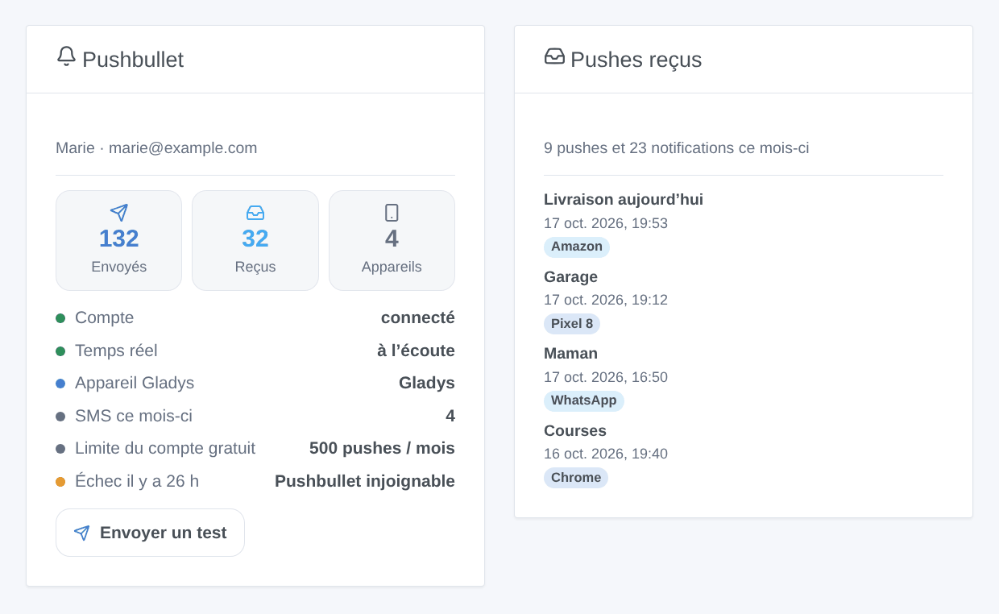
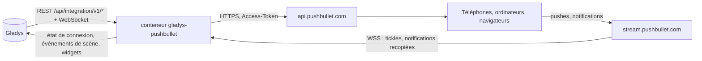
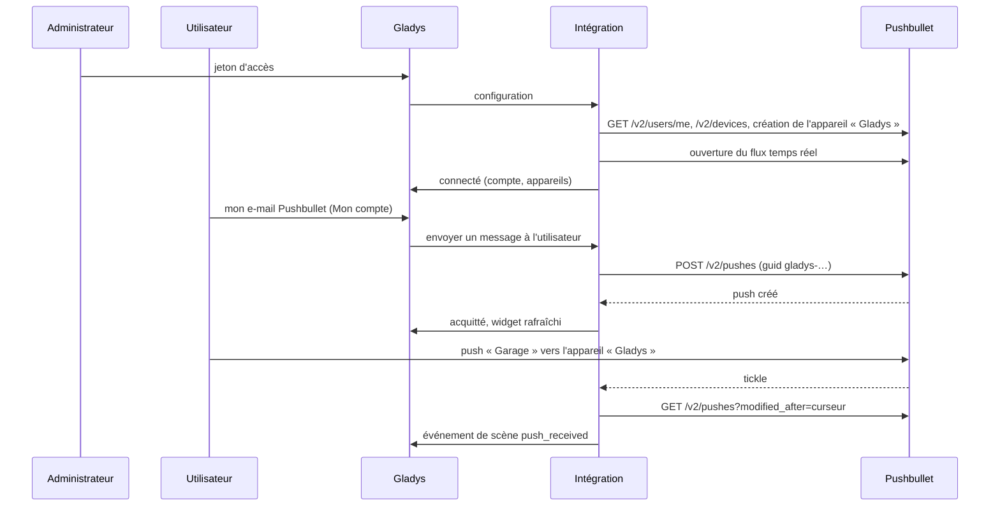

# Gladys Pushbullet

[English](README.md) · **Français** · [Deutsch](README.de.md) · [Español](README.es.md)

[](LICENSE)
[](https://github.com/William-De71/gladys-pushbullet/releases)
[](https://github.com/William-De71/gladys-pushbullet/actions/workflows/release.yml)
[](https://gladysassistant.com)


Intégration externe pour [Gladys Assistant](https://gladysassistant.com) qui envoie les notifications de Gladys **sous forme de pushes [Pushbullet](https://www.pushbullet.com)**, vers vos téléphones, ordinateurs et navigateurs, images de caméra comprises. Les scènes peuvent aussi réagir aux pushes et aux notifications Android qui arrivent sur votre compte Pushbullet, envoyer des notes, des liens et des SMS, et deux widgets de tableau de bord affichent le compte et ce qui est arrivé.

Documentation utilisateur : [English](docs/en.md) · [Français](docs/fr.md) · [Deutsch](docs/de.md) · [Español](docs/es.md).

> Intégration communautaire, ni affiliée à Pushbullet Inc. ni approuvée par elle.

## Fonctionnalités

- **Canal de notification** (envoi seul) : chaque utilisateur saisit l'e-mail de son compte Pushbullet dans le bloc « Mon compte » (et, s'il le souhaite, un appareil) ; chaque notification de Gladys qui lui est adressée part en push, une image de caméra en image.
- **Un appareil « Gladys »** ajouté au compte : poussez vers Gladys depuis le menu Partager d'un téléphone, et voyez d'où viennent les pushes de Gladys.
- **Réception en temps réel** via le flux de Pushbullet : aucune interrogation périodique.
- **Déclencheurs de scène** : push reçu (filtres sur la destination, la provenance, le premier mot, l'expéditeur et le genre), notification du téléphone recopiée par Android (filtres sur l'application, le téléphone et le premier mot ; chiffrement de bout en bout pris en charge), push non envoyé.
- **Actions de scène** : envoyer une note ou un lien à tous les appareils, un appareil, une autre personne ou un canal ; envoyer un SMS via un téléphone Android.
- **Widgets de tableau de bord** : compte, pushes reçus.
- **Boutons de l'écran de configuration** : tester la connexion, envoyer un push de test.
- Anglais, français, allemand et espagnol partout.



## Fonctionnement




De la configuration à un push, et retour :



Chaque push de Gladys porte un `guid` commençant par `gladys-` : un push relancé n'est pas créé deux fois, et la réception ne le prend jamais pour un push de l'utilisateur.

### Transport

`transports: ["cloud"]` : l'intégration ne parle qu'à Pushbullet (`api.pushbullet.com`, `stream.pushbullet.com`, et `upload.pushbullet.com` pour les images). Le texte des notifications, les pushes reçus et, s'ils sont activés, les notifications recopiées de votre téléphone passent par les serveurs de Pushbullet.

## Notifications et destinataires

| E-mail dans « Mon compte »         | Appareil dans « Mon compte » | Le push va à                            |
| ---------------------------------- | ---------------------------- | --------------------------------------- |
| L'e-mail du compte du jeton        | vide                         | tous les appareils du compte            |
| L'e-mail du compte du jeton        | `Pixel 8`                    | l'appareil nommé Pixel 8                |
| Un autre utilisateur de Pushbullet | ignoré                       | cet utilisateur (ses propres appareils) |
| Une adresse sans Pushbullet        | ignoré                       | un e-mail, envoyé par Pushbullet        |

Une image jointe par Gladys (« Envoyer une image de caméra ») est téléversée et envoyée en push de fichier. Un compte gratuit envoie 500 pushes par mois, toutes applications confondues.

## Déclencheurs, actions de scène et widgets

| Genre       | Clé                     | Cas d'usage                                                                                                         |
| ----------- | ----------------------- | ------------------------------------------------------------------------------------------------------------------- |
| Déclencheur | `push_received`         | Commander une scène depuis un téléphone : partager « Garage » vers l'appareil « Gladys » ; réagir à un lien partagé |
| Déclencheur | `notification_mirrored` | Réagir à une application du téléphone : livraison, sonnette, appel manqué                                           |
| Déclencheur | `push_not_sent`         | Prévenir par un autre canal quand les pushes ne partent plus (quota, jeton révoqué, Pushbullet en panne)            |
| Action      | `send_push`             | Un lien vers un tableau de bord, une note à quelqu'un qui n'utilise pas Gladys, un canal familial                   |
| Action      | `send_sms`              | Un SMS depuis votre propre téléphone et forfait, au voisin ou à la baby-sitter                                      |
| Widget      | `account`               | Pushes du mois face à la limite gratuite, appareils, temps réel, dernier échec, bouton de test                      |
| Widget      | `recent`                | Les derniers pushes et notifications du téléphone reçus                                                             |

Exemples : _push commençant par GARAGE sur l'appareil « Gladys » depuis un de mes appareils_ → fermer le garage ; _notification de l'application de livraison_ → allumer l'entrée ; _alarme_ → push avec un lien vers les caméras et SMS au voisin. Un autre utilisateur de Pushbullet peut pousser vers votre e-mail : filtrez sur la provenance ou l'expéditeur avant d'ouvrir une porte. Une action de scène ne déclenche jamais de déclencheur, et `push_not_sent` ne se déclenche qu'une fois jusqu'à un push réussi : une scène qui prévient par ce même canal ne peut pas boucler.

## Prérequis

- Gladys Assistant 5.3.0 ou plus récent (widgets et scènes, le catalogue mots-clés/pays de Gladys 5.3) ; les instances plus anciennes ne peuvent pas installer l'intégration.
- Un compte Pushbullet et ses applications sur vos appareils ; en option un téléphone Android pour les SMS et les notifications recopiées.

## Installation

- **Depuis le store** : Intégrations → Pushbullet → Installer.
- **Depuis l'URL du dépôt** : Intégrations → intégration externe → `https://github.com/William-De71/gladys-pushbullet`.
- **Mode développeur** : lancez `npm start` avec les variables données par Gladys (voir Développement).

## Configuration

| Champ                                       | Défaut    | Rôle                                                                              |
| ------------------------------------------- | --------- | --------------------------------------------------------------------------------- |
| Jeton d'accès                               | —         | Pushbullet → Settings → Account → Create Access Token ; `secret`, chiffré         |
| Titre des notifications                     | Gladys    | Au-dessus de chaque message                                                       |
| Langue du push de test                      | anglais   | Le push de test seulement (un bouton ne reçoit pas la langue de l'utilisateur)    |
| Ajouter un appareil « Gladys »              | activé    | Appareil pour pousser vers Gladys seule, origine des pushes de Gladys             |
| Nom de l'appareil                           | Gladys    | Utilisé à la création de l'appareil                                               |
| Pushes reçus                                | activé    | Flux temps réel, `push_received`                                                  |
| Notifications recopiées                     | désactivé | `notification_mirrored`                                                           |
| Mot de passe du chiffrement de bout en bout | —         | `secret`, seulement si le chiffrement est activé dans les applications Pushbullet |
| Mon compte → e-mail                         | —         | Par utilisateur : le compte Pushbullet de ses notifications                       |
| Mon compte → appareil                       | —         | Par utilisateur, facultatif : un appareil du compte du jeton                      |

## Utilisation

1. Créez un jeton d'accès sur pushbullet.com, collez-le dans la configuration, puis cliquez sur **Tester la connexion** et **Envoyer un push de test**.
2. Chaque utilisateur saisit l'e-mail de son compte Pushbullet dans **Mon compte**.
3. Ajoutez les widgets à un tableau de bord, et créez des scènes avec les déclencheurs et les actions.

## Développement

```bash
npm install
npm test                       # node --test, ne touche jamais le réseau
npm run lint                   # ESLint
npm run format:check           # Prettier
npx github:GladysAssistant/integration-store . --skip-image-check
scripts/build-cover.sh         # cover.jpg depuis docs/assets/cover.svg
docs/illustrations/render.sh   # docs/assets/widgets.<lang>.png
```

En local, le SDK lit `GLADYS_HOST_API_URL`, `GLADYS_INTEGRATION_TOKEN` et `GLADYS_INTEGRATION_SELECTOR` (donnés par Gladys en mode développeur). `DEBUG=gladys-integration-sdk` affiche les journaux du SDK.

Les tests couvrent les raisons d'erreur de l'API, les relances (une seule, avec le même guid), le téléversement, le déchiffrement de bout en bout (les vecteurs de docs.pushbullet.com), le flux (reconnexion, chien de garde), la réception (historique, pushes de Gladys, pushes en retard, redémarrage), les destinataires des notifications, les événements de scène et leurs transitions, les widgets (`validateWidgetContent`), le manifeste, les quatre langues, le script de release, et toute l'intégration face au faux Gladys du SDK, à un faux Pushbullet et à un faux flux. `test/structure.test.js` fige toutes les clés que les utilisateurs enregistrent.

## Processus de release


Chaque fusion sur `main` lance la CI, puis calcule la version à partir des [Conventional Commits](https://www.conventionalcommits.org/) depuis le dernier tag : `feat` → mineure, `fix` / `perf` → correctif, `!` ou `BREAKING CHANGE` → majeure (une mineure sous 1.0.0) ; `docs`, `chore`, `ci`, `test`, `style`, `refactor`, `build` seuls ne publient rien. La section du changelog est générée, le tag poussé, l'image multi-architecture construite, puis `main` reçoit le commit de release, la GitHub Release est créée et un dernier job vérifie l'image publique, le validateur du store et le topic.

- Le titre de la pull request devient le commit de squash, puis la ligne du changelog : écrivez-le en anglais, pour l'utilisateur (`pr-title.yml` le vérifie). N'éditez jamais `CHANGELOG.md` à la main.
- La 1.0.0 est une décision : Actions → Release → Run workflow avec `release-as: 1.0.0`. `dry-run` affiche la version et les notes sans rien publier.
- **Branche protégée** : la release pousse son commit sur `main` avec `GITHUB_TOKEN`. Avec un ruleset sur `main`, ajoutez GitHub Actions à sa liste de contournement (ou poussez via une GitHub App), sinon le job de publication échoue avec des instructions.
- Après la première release, rendez public le package `ghcr.io` (Package settings → Change visibility), sinon Gladys ne peut pas le télécharger.

## Dépannage

Voir [docs/fr.md](docs/fr.md#dépannage). Signalez les problèmes avec les versions de Gladys et de l'intégration, compte gratuit ou Pro, le type d'appareils et les journaux de l'intégration (les adresses e-mail sont masquées ; ne collez jamais le jeton).

## Contribuer

Les issues et pull requests sont les bienvenues. Lancez `npm run format:check && npm run lint && npm test` avant d'ouvrir une pull request, et ne changez aucune clé enregistrée (voir [CLAUDE.md](CLAUDE.md)).

## Sécurité

Voir [SECURITY.md](SECURITY.md) : signalez les vulnérabilités en privé. Le jeton d'accès et le mot de passe de chiffrement sont des champs `secret`, jamais journalisés, jamais dans un message d'erreur, un événement de scène ou un widget ; l'URL du flux, qui porte le jeton, n'est jamais journalisée, et le serveur de téléversement ne le reçoit jamais. Les adresses e-mail sont masquées dans les journaux. Le jeton donne un accès complet au compte Pushbullet : l'intégration se contente d'envoyer des pushes et des SMS, de lire les pushes et d'ajouter un appareil.

## Captures à venir

Les images ci-dessus sont des illustrations, pas des captures d'écran. Les vraies captures iront dans `docs/assets/screenshots/` (PNG, 1280 × 800) : `configuration.png`, `my-account.png`, `scene-trigger.png`, `dashboard.png`, et une capture de téléphone `push-on-phone.png` (1080 × 2340).

## Licence

[Licence Apache 2.0](LICENSE) — voir aussi [NOTICE](NOTICE). Pushbullet est une marque de Pushbullet Inc. ; cette intégration communautaire n'y est pas affiliée. Merci à la documentation et au SDK de Gladys.
