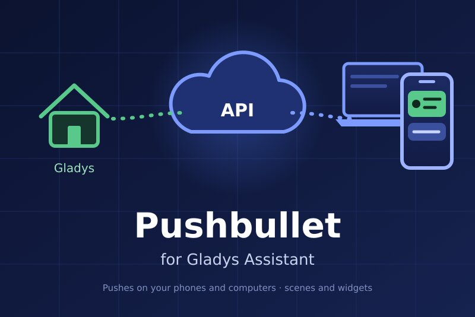
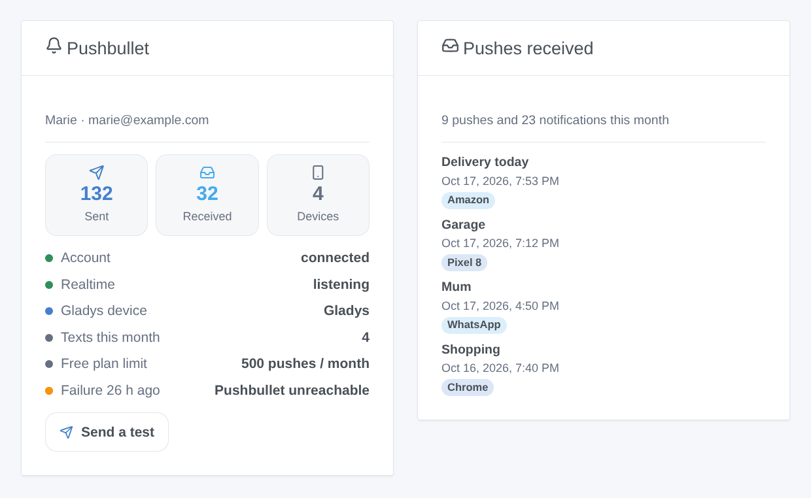
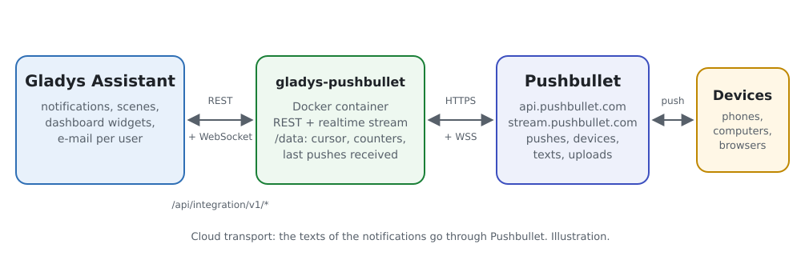
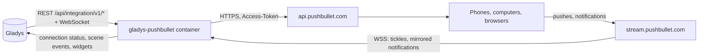
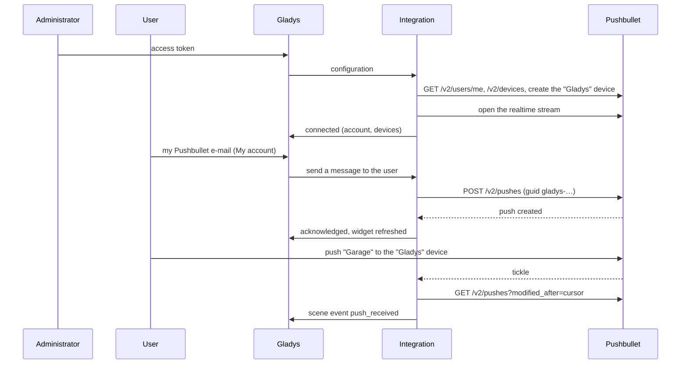

# Gladys Pushbullet

**English** · [Français](README.fr.md) · [Deutsch](README.de.md) · [Español](README.es.md)

[](LICENSE)
[](https://github.com/William-De71/gladys-pushbullet/releases)
[](https://github.com/William-De71/gladys-pushbullet/actions/workflows/release.yml)
[](https://gladysassistant.com)



[Gladys Assistant](https://gladysassistant.com) external integration that sends the notifications of Gladys **as [Pushbullet](https://www.pushbullet.com) pushes**, to your phones, computers and browsers, camera pictures included. Scenes can also react to the pushes and the Android notifications that reach your Pushbullet account, send notes, links and SMS, and two dashboard widgets show the account and what arrived.

User documentation: [English](docs/en.md) · [Français](docs/fr.md) · [Deutsch](docs/de.md) · [Español](docs/es.md).

> Community integration, not affiliated with nor endorsed by Pushbullet Inc.

## Features

- **Notification channel** (send-only): each user enters the e-mail of their Pushbullet account in the "My account" block (and optionally one device); every Gladys notification addressed to them leaves as a push, a camera picture as an image.
- **A "Gladys" device** added to the account: push to Gladys from the share menu of a phone, and see where the pushes of Gladys come from.
- **Realtime reception** through the Pushbullet stream: no polling.
- **Scene triggers**: push received (filters on the target, the origin, the first word, the sender and the kind), phone notification mirrored by Android (filters on the application, the phone and the first word; end-to-end encryption supported), push not sent.
- **Scene actions**: send a note or a link to all the devices, one device, another person or a channel; send an SMS through an Android phone.
- **Dashboard widgets**: account, pushes received.
- **Configuration screen buttons**: test the connection, send a test push.
- English, French, German and Spanish everywhere.



## How it works





From the configuration to a push, and back:



Every push of Gladys carries a `guid` starting with `gladys-`: a retried push is not created twice, and the reception never takes it for a push of the user.

### Transport

`transports: ["cloud"]`: the integration only talks to Pushbullet (`api.pushbullet.com`, `stream.pushbullet.com`, and `upload.pushbullet.com` for the pictures). The texts of the notifications, the pushes received and, when turned on, the mirrored notifications of your phone go through the Pushbullet servers.

## Notifications and targets

| E-mail in "My account"            | Device in "My account" | The push goes to              |
| --------------------------------- | ---------------------- | ----------------------------- |
| The e-mail of the token's account | empty                  | every device of the account   |
| The e-mail of the token's account | `Pixel 8`              | the device named Pixel 8      |
| Another Pushbullet user           | ignored                | that user (their own devices) |
| An address without Pushbullet     | ignored                | an e-mail, sent by Pushbullet |

A picture attached by Gladys ("Send a camera image") is uploaded and sent as a file push. A free account sends 500 pushes per month, every app together.

## Scene triggers, actions and widgets

| Kind    | Key                     | Use case                                                                                      |
| ------- | ----------------------- | --------------------------------------------------------------------------------------------- |
| Trigger | `push_received`         | Command a scene from a phone: share "Garage" to the "Gladys" device; react to a shared link   |
| Trigger | `notification_mirrored` | React to an app of the phone: delivery app, doorbell app, missed call                         |
| Trigger | `push_not_sent`         | Warn through another channel when pushes stop leaving (quota, token revoked, Pushbullet down) |
| Action  | `send_push`             | A link to a dashboard, a note to someone who is not a Gladys user, a channel of the family    |
| Action  | `send_sms`              | An SMS from your own phone and plan, to the neighbor or the babysitter                        |
| Widget  | `account`               | Pushes of the month against the free limit, devices, realtime link, last failure, test button |
| Widget  | `recent`                | The last pushes and phone notifications received                                              |

Examples: _push starting with GARAGE on the "Gladys" device from one of my devices_ → close the garage; _notification of the delivery app_ → porch light on; _alarm_ → push with a link to the cameras and SMS to the neighbor. Another Pushbullet user can push to your e-mail: filter on the origin or the sender before opening a door. A scene action never fires a trigger, and `push_not_sent` fires once until a push goes through: a scene warning through this same channel cannot loop.

## Requirements

- Gladys Assistant 5.1.0 or later (widgets and scenes); older instances cannot install the integration.
- A Pushbullet account and its apps on your devices; optionally an Android phone for SMS and mirrored notifications.

## Installation

- **From the store**: Integrations → Pushbullet → Install.
- **From the repository URL**: Integrations → external integration → `https://github.com/William-De71/gladys-pushbullet`.
- **Developer mode**: run `npm start` with the variables given by Gladys (see Development).

## Configuration

| Field                          | Default | Meaning                                                                    |
| ------------------------------ | ------- | -------------------------------------------------------------------------- |
| Access token                   | —       | Pushbullet → Settings → Account → Create Access Token; `secret`, encrypted |
| Title of the notifications     | Gladys  | Above each message                                                         |
| Language of the test push      | English | The test push only (a button does not get the language of the user)        |
| Add a "Gladys" device          | on      | Device to push to Gladys only, origin of the pushes of Gladys              |
| Name of the device             | Gladys  | Used when the device is created                                            |
| Pushes received                | on      | Realtime stream, `push_received`                                           |
| Mirrored notifications         | off     | `notification_mirrored`                                                    |
| End-to-end encryption password | —       | `secret`, only with encryption on in the Pushbullet apps                   |
| My account → e-mail            | —       | Per user: the Pushbullet account of their notifications                    |
| My account → device            | —       | Per user, optional: one device of the account of the token                 |

## Usage

1. Create an access token on pushbullet.com, paste it in the configuration, then click **Test the connection** and **Send a test push**.
2. Each user enters the e-mail of their Pushbullet account in **My account**.
3. Add the widgets to a dashboard, and build scenes with the triggers and actions.

## Development

```bash
npm install
npm test                       # node --test, never touches the network
npm run lint                   # ESLint
npm run format:check           # Prettier
npx github:GladysAssistant/integration-store . --skip-image-check
scripts/build-cover.sh         # cover.jpg from docs/assets/cover.svg
docs/illustrations/render.sh   # docs/assets/widgets.<lang>.png
```

Locally, the SDK reads `GLADYS_HOST_API_URL`, `GLADYS_INTEGRATION_TOKEN` and `GLADYS_INTEGRATION_SELECTOR` (given by Gladys in developer mode). `DEBUG=gladys-integration-sdk` shows the SDK logs.

The tests cover the error reasons of the API, the retries (once, with the same guid), the upload, the end-to-end decryption (the vectors of docs.pushbullet.com), the stream (reconnection, watchdog), the reception (history, own pushes, late pushes, restart), the targets of the notifications, the scene events and their transitions, the widgets (`validateWidgetContent`), the manifest, the four languages, the release script, and the whole integration against the fake Gladys of the SDK, a fake Pushbullet and a fake stream. `test/structure.test.js` freezes every key users store.

## Release process


Every merge on `main` runs the CI, then computes the version from the [Conventional Commits](https://www.conventionalcommits.org/) since the last tag: `feat` → minor, `fix` / `perf` → patch, `!` or `BREAKING CHANGE` → major (a minor below 1.0.0); `docs`, `chore`, `ci`, `test`, `style`, `refactor`, `build` alone publish nothing. The changelog section is generated, the tag pushed, the multi-architecture image built, then `main` receives the release commit, the GitHub Release is created and a last job checks the public image, the store validator and the topic.

- The pull request title becomes the squash commit, then the changelog line: write it in English, for the user (`pr-title.yml` checks it). Never edit `CHANGELOG.md` by hand.
- 1.0.0 is a decision: Actions → Release → Run workflow with `release-as: 1.0.0`. `dry-run` shows the version and the notes without publishing.
- **Protected branch**: the release pushes its commit to `main` with `GITHUB_TOKEN`. With a ruleset on `main`, add GitHub Actions to its bypass list (or push through a GitHub App), otherwise the publish job fails with instructions.
- After the first release, make the `ghcr.io` package public (Package settings → Change visibility), or Gladys cannot pull it.

## Troubleshooting

See [docs/en.md](docs/en.md#troubleshooting). Report issues with the versions of Gladys and of the integration, free or Pro account, the kind of devices and the logs of the integration (e-mail addresses are masked; never paste the token).

## Contributing

Issues and pull requests are welcome. Run `npm run format:check && npm run lint && npm test` before opening a pull request, and keep every stored key unchanged (see [CLAUDE.md](CLAUDE.md)).

## Security

See [SECURITY.md](SECURITY.md): report vulnerabilities privately. The access token and the encryption password are `secret` fields, never logged, never in an error message, a scene event or a widget; the stream URL that carries the token is never logged, and the upload server never receives it. E-mail addresses are masked in the logs. The token gives full access to the Pushbullet account: the integration only sends pushes and SMS, reads the pushes and adds one device.

## Screenshots to come

The images above are illustrations, not screenshots. Real screenshots will go in `docs/assets/screenshots/` (PNG, 1280 × 800): `configuration.png`, `my-account.png`, `scene-trigger.png`, `dashboard.png`, and a phone screenshot `push-on-phone.png` (1080 × 2340).

## License

[Apache License 2.0](LICENSE) — see also [NOTICE](NOTICE). Pushbullet is a trademark of Pushbullet Inc.; this community integration is not affiliated with it. Thanks to the Gladys documentation and SDK.
